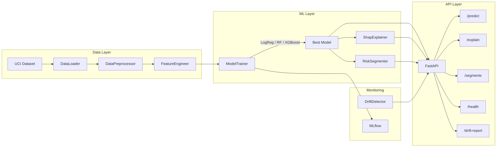

# 🏦 FinRisk AI

> **Machine-learning platform for credit-default risk prediction, explainability, and monitoring.**


---

## Architecture



## ✨ Features

| Category | Capabilities |
|---|---|
| **Prediction** | Single & batch credit-default risk scoring |
| **Explainability** | SHAP-based per-prediction explanations & global risk factors |
| **Segmentation** | Cluster-based risk segments with profiles |
| **Monitoring** | KS / chi² data-drift detection, model quality tracking |
| **Experiment Tracking** | MLflow integration for model comparison |
| **Deployment** | Docker & Docker Compose with health checks |

## 🛠️ Tech Stack

- **Language:** Python 3.11
- **ML:** scikit-learn · XGBoost · SHAP · imbalanced-learn
- **API:** FastAPI · Uvicorn · Pydantic v2
- **Monitoring:** scipy (KS / chi²) · evidently
- **Experiment Tracking:** MLflow
- **Visualization:** matplotlib · seaborn · plotly
- **Deployment:** Docker · Docker Compose

---

## 🚀 Quick Start

### Local Setup

```bash
# 1. Clone & enter the project
cd "FINRISK AI"

# 2. Create a virtual environment
python -m venv .venv
.venv\Scripts\activate        # Windows
# source .venv/bin/activate   # macOS / Linux

# 3. Install dependencies
pip install -r requirements.txt

# 4. Download dataset & train models
python -c "from src.data.loader import download_dataset; download_dataset()"
python scripts/train.py

# 5. Launch the API
uvicorn src.api.main:app --reload --port 8000

# 6. Launch the Interactive Streamlit Dashboard
streamlit run app.py
```

- **Interactive Dashboard:** [http://localhost:8501](http://localhost:8501)
- **FastAPI Docs:** [http://localhost:8000/docs](http://localhost:8000/docs)

### Docker

```bash
# Build & run all services (API, MLflow, and Streamlit Dashboard)
docker-compose up --build -d

# Dashboard → http://localhost:8501
# API       → http://localhost:8000
# MLflow    → http://localhost:5000
```

---

## 📡 API Reference

All endpoints are prefixed with `/api/v1`.

| Method | Endpoint | Description |
|--------|----------|-------------|
| `POST` | `/predict` | Single-customer default prediction |
| `POST` | `/predict/batch` | Batch predictions |
| `POST` | `/explain` | Prediction + SHAP explanation |
| `GET`  | `/risk-factors` | Global SHAP risk factor ranking |
| `GET`  | `/segments` | Risk-segment profiles |
| `GET`  | `/health` | Service health check |
| `GET`  | `/drift-report` | Latest data-drift report |
| `POST` | `/monitor/check-drift` | Trigger drift check with new data |

### Example — Single Prediction

```bash
curl -X POST http://localhost:8000/api/v1/predict \
  -H "Content-Type: application/json" \
  -d '{
    "LIMIT_BAL": 200000, "SEX": 2, "EDUCATION": 2, "MARRIAGE": 1,
    "AGE": 35, "PAY_0": 0, "PAY_2": 0, "PAY_3": -1, "PAY_4": -1,
    "PAY_5": -1, "PAY_6": -1, "BILL_AMT1": 50000, "BILL_AMT2": 48000,
    "BILL_AMT3": 45000, "BILL_AMT4": 42000, "BILL_AMT5": 40000,
    "BILL_AMT6": 38000, "PAY_AMT1": 5000, "PAY_AMT2": 4800,
    "PAY_AMT3": 4500, "PAY_AMT4": 4200, "PAY_AMT5": 4000,
    "PAY_AMT6": 3800
  }'
```

**Response:**

```json
{
  "customer_id": null,
  "default_probability": 0.1823,
  "risk_label": "Low Risk",
  "risk_segment": "1",
  "threshold_used": 0.5,
  "model_used": "XGBClassifier"
}
```

---

## 📂 Project Structure

```
FINRISK AI/
├── config.yaml                 # Centralised configuration
├── requirements.txt            # Python dependencies
├── setup.py                    # Package setup
├── Dockerfile                  # Production Docker image
├── docker-compose.yml          # API + MLflow services
├── .dockerignore
│
├── data/
│   ├── raw/                    # Raw UCI dataset
│   └── processed/              # Cleaned & feature-engineered data
│
├── models/                     # Saved model artifacts (.joblib)
│   ├── best_model.joblib
│   ├── preprocessor.joblib
│   └── feature_engineer.joblib
│
├── src/
│   ├── config.py               # Config loader
│   ├── data/
│   │   ├── loader.py           # Dataset download & loading
│   │   └── preprocessor.py     # Cleaning & scaling pipeline
│   ├── features/
│   │   └── engineer.py         # Feature engineering
│   ├── models/
│   │   └── trainer.py          # Model training & evaluation
│   ├── explainability/
│   │   └── shap_explainer.py   # SHAP explanations
│   ├── segmentation/
│   │   └── clustering.py       # Risk segmentation
│   ├── monitoring/
│   │   └── drift_detector.py   # Data & model drift detection
│   └── api/
│       ├── main.py             # FastAPI application
│       ├── routes.py           # API route definitions
│       └── schemas.py          # Pydantic request/response models
│
├── tests/
│   ├── test_preprocessor.py    # Preprocessor unit tests
│   ├── test_models.py          # Model trainer unit tests
│   └── test_api.py             # API integration tests
│
├── notebooks/
│   └── 01_eda.ipynb            # Exploratory data analysis
│
├── scripts/
│   ├── run_eda.py              # CLI EDA runner
│   └── train.py                # CLI training runner
│
├── outputs/
│   ├── figures/                # EDA & SHAP plots
│   └── monitoring/             # Drift reports (JSON)
│
└── mlruns/                     # MLflow experiment store
```

---

## 📊 Dataset

**UCI Default of Credit Card Clients** — 30,000 customers from a Taiwanese bank (2005).

| Property | Value |
|----------|-------|
| Rows | 30,000 |
| Features | 23 (demographic + payment history) |
| Target | `default` (binary: 0 = no default, 1 = default) |
| Default Rate | ~22 % |

---

## 📈 Model Performance

| Model | Accuracy | F1 (default) | AUC-ROC |
|-------|----------|-------------|---------|
| Logistic Regression | _TBD_ | _TBD_ | _TBD_ |
| Random Forest | _TBD_ | _TBD_ | _TBD_ |
| **XGBoost** | _TBD_ | _TBD_ | _TBD_ |

> Performance metrics will be populated after training completes.

---

## 🔬 MLflow Experiment Tracking

```bash
# Start MLflow UI standalone
mlflow ui --port 5000

# Or use docker-compose (already included)
docker-compose up mlflow
```

Visit [http://localhost:5000](http://localhost:5000) to compare experiments, view metrics, and download artifacts.

---

## 📡 Monitoring & Drift Detection

The `DriftDetector` class continuously monitors incoming data for distribution shifts:

- **Numeric features:** Kolmogorov-Smirnov two-sample test
- **Categorical features:** Chi-squared goodness-of-fit test
- **Model quality:** Accuracy / F1 / AUC degradation alerts (> 5 % drop)

Trigger a manual check:

```bash
curl -X POST http://localhost:8000/api/v1/monitor/check-drift \
  -H "Content-Type: application/json" \
  -d '[{"LIMIT_BAL": 100000, "SEX": 1, ...}]'
```

Reports are saved to `outputs/monitoring/`.

---

## 🤝 Contributing

1. Fork the repository
2. Create a feature branch (`git checkout -b feature/my-feature`)
3. Commit your changes (`git commit -m "Add my feature"`)
4. Push to the branch (`git push origin feature/my-feature`)
5. Open a Pull Request

Please include tests for any new functionality.

---

## 📄 License

This project is licensed under the **MIT License** — see the [LICENSE](LICENSE) file for details.
