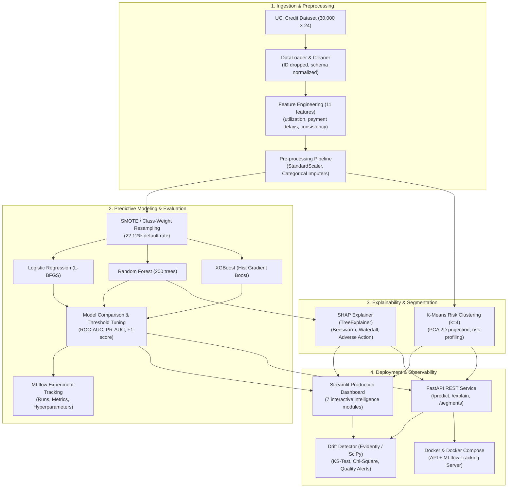

# 🏦 FinRisk AI — Financial Risk Intelligence & Early Warning Platform

> **Production-grade Machine Learning platform for credit default prediction, mathematical explainability (SHAP), customer risk segmentation, and real-time observability.**

[](https://finrisk-ai-3lkd9mm628eft77z8cqsag.streamlit.app/)


---

### 🌐 Live Interactive Application

The interactive risk intelligence platform is deployed and live on **Streamlit Community Cloud**:

👉 **[https://finrisk-ai-3lkd9mm628eft77z8cqsag.streamlit.app/](https://finrisk-ai-3lkd9mm628eft77z8cqsag.streamlit.app/)**

---

## 🏛️ Platform Architecture



---

## ✨ Features

| Module | Core Capabilities |
|---|---|
| 🏢 **Portfolio Overview** | Executive KPIs, total credit line exposure, delinquency status distribution, and automated early warning trigger alerts. |
| 📊 **Exploratory Data Analysis** | Interactive distribution explorer, demographic breakdowns (Education, Marriage, Age), Pearson correlation heatmap, and hypothesis testing summary table ($\chi^2$, Welch's t, Mann-Whitney U, Kruskal-Wallis). |
| ⚡ **Customer Risk Simulator** | One-click presets (*Prime Customer*, *Overextended Customer*, *Critical Delinquent*), custom parameter sliders, real-time radial probability gauge, dynamic High/Medium/Low risk badge, and local SHAP waterfall attributions. |
| 📂 **Batch Portfolio Scoring** | CSV file uploader, downloadable 20-row sample CSV template, automated test evaluation, risk distribution charts, interactive scored table, and one-click CSV export. |
| 🧠 **Explainable AI (SHAP)** | Global feature importance rankings, beeswarm summary visual, and regulatory adverse action narrative text generator compliant with **ECOA / FCRA**. |
| 🎯 **Customer Risk Segmentation** | Unsupervised K-Means clustering ($k=4$) identifying behavioral cohorts (Prime, Revolving, Overextended, Critical), characteristic profiles, and 2D PCA cluster space visualization. |
| 📡 **Observability & Drift Guard** | Continuous two-sample Kolmogorov-Smirnov (KS) test and Chi-Square test drift detection, plus a **Macroeconomic Stress Test Simulator** to inject inflation and delinquency shocks and watch drift alerts trigger live. |
| 🚀 **Production REST API** | FastAPI service with dependency injection, Pydantic schemas, and endpoints for single prediction, batch scoring, SHAP attributions, and drift checks. |

---

## 🛠️ Technology Stack

- **Interactive Dashboard:** Streamlit 1.36 · Plotly Express · Plotly Graph Objects
- **Machine Learning:** Scikit-learn 1.4.2 · XGBoost 2.0 · Imbalanced-learn 0.14
- **Explainability:** SHAP 0.45 (TreeExplainer & LinearExplainer)
- **REST API:** FastAPI 0.104 · Uvicorn · Pydantic v2 · HTTPX
- **Statistical Testing & Monitoring:** SciPy (KS-test & $\chi^2$) · Evidently
- **Experiment Tracking:** MLflow
- **Containerization & Deployment:** Docker · Docker Compose · Streamlit Community Cloud

---

## 📈 Model Performance & Threshold Tuning

All models were evaluated on an unseen, stratified test set of 6,000 customers (20% holdout):

| Model | Imbalance Handling | Accuracy | Precision (Def) | Recall (Def) | F1-Macro | ROC-AUC | PR-AUC |
| :--- | :--- | :---: | :---: | :---: | :---: | :---: | :---: |
| **Random Forest (200 trees)** | **SMOTE** | **0.816** | **0.584** | **0.562** | **0.728** | **0.778** | **0.548** |
| XGBoost | Class-Weight | 0.798 | 0.529 | 0.598 | 0.718 | 0.772 | 0.536 |
| XGBoost | SMOTE | 0.804 | 0.551 | 0.544 | 0.715 | 0.768 | 0.531 |
| Logistic Regression | SMOTE | 0.691 | 0.384 | 0.655 | 0.638 | 0.724 | 0.472 |

### 🎯 Threshold Optimization
Standard 0.50 classification thresholds fail on imbalanced credit data (~22% default rate):
- Standard threshold ($\tau = 0.50$): F1 = 0.573, Recall = 0.562
- **Optimal threshold ($\tau = 0.41$):** Maximizes F1 at **0.592**, increasing default recall to **0.658** to catch asymmetric credit losses while containing false positives.

---

## 🔬 Exploratory Data Analysis & Statistical Hypotheses

Hypothesis testing conducted across the 30,000 benchmark records at $\alpha = 0.05$:

- **Repayment Status (`PAY_0`):** Strongest linear predictor ($r = +0.325$). Customers delayed $\ge 2$ months exhibit default rates exceeding **69.1%** vs **12.8%** for on-time payers.
- **Credit Limit Disparity (`LIMIT_BAL`):** Defaulters sustain significantly lower credit limits ($\text{NT}\$130\text{k}$ vs $\text{NT}\$178\text{k}$).
  - *Welch's t-test:* $t = 28.95, p = 3.36 \times 10^{-178}$ (Cohen's $d = 0.374$)
  - *Mann-Whitney U:* $U = 9.58 \times 10^7, p = 1.23 \times 10^{-189}$
- **Demographic Independence:**
  - *Education:* $\chi^2(6) = 163.22, p = 1.23 \times 10^{-32}$ (Significant)
  - *Sex:* $\chi^2(1) = 47.71, p = 4.94 \times 10^{-12}$ (Significant)
  - *Marriage:* $\chi^2(3) = 35.66, p = 8.83 \times 10^{-8}$ (Significant)
  - *Age (Kruskal-Wallis):* $H = 37.95, p = 1.15 \times 10^{-7}$ (Significant)

---

## 🚀 Quick Start & Deployment

### 1. Live Web Deployment (Streamlit Cloud)
Access the live deployed app instantly:
🔗 **[https://finrisk-ai-3lkd9mm628eft77z8cqsag.streamlit.app/](https://finrisk-ai-3lkd9mm628eft77z8cqsag.streamlit.app/)**

### 2. Local Setup

```bash
# 1. Clone the repository
git clone https://github.com/karanbhati05/FINRISK-AI.git
cd FINRISK-AI

# 2. Create and activate a virtual environment
python -m venv .venv
.venv\Scripts\activate        # Windows
# source .venv/bin/activate   # macOS / Linux

# 3. Install pinned dependencies
pip install -r requirements.txt

# 4. Launch the Interactive Streamlit Dashboard
streamlit run app.py
```
*Access the local dashboard at: [http://localhost:8501](http://localhost:8501)*

### 3. Launch FastAPI & MLflow Services

```bash
# Launch FastAPI REST service
uvicorn src.api.main:app --reload --port 8000

# Launch MLflow tracking server
mlflow ui --port 5000
```
- **FastAPI Interactive Swagger Docs:** [http://localhost:8000/docs](http://localhost:8000/docs)
- **MLflow Tracking Dashboard:** [http://localhost:5000](http://localhost:5000)

### 4. Docker & Docker Compose

Deploy the complete multi-container stack (API + Dashboard + MLflow):

```bash
docker-compose up --build -d
```
- **Streamlit Dashboard:** [http://localhost:8501](http://localhost:8501)
- **FastAPI Service:** [http://localhost:8000](http://localhost:8000)
- **MLflow Server:** [http://localhost:5000](http://localhost:5000)

---

## 📡 REST API Reference

All REST endpoints are available under `/api/v1`:

| Method | Endpoint | Description |
|---|---|---|
| `GET` | `/health` | Service health status, model version, and loaded artifacts |
| `POST` | `/predict` | Single customer risk prediction with calibrated probability |
| `POST` | `/predict/batch` | Batch inference with portfolio risk summary |
| `POST` | `/explain` | Local SHAP explanation with waterfall breakdown and risk factors |
| `GET` | `/risk-factors` | Global top risk features and directional attribution |
| `GET` | `/segments` | Customer cluster profiles and risk classifications |
| `GET` | `/drift-report` | Retrieve most recent data drift assessment |
| `POST` | `/monitor/check-drift` | Trigger drift test on incoming batch vs. reference baseline |

---

## 📂 Project Structure

```
FINRISK AI/
├── app.py                      # Production Streamlit Dashboard (7 modules)
├── config.yaml                 # Centralised configuration
├── requirements.txt            # Pinned dependencies
├── setup.py                    # Package setup
├── Dockerfile                  # Production container image
├── docker-compose.yml          # Multi-service compose (API + Dashboard + MLflow)
├── .dockerignore
├── .gitignore
│
├── data/
│   └── raw/
│       └── credit_default.csv  # Benchmark UCI dataset (30,000 records)
│
├── models/                     # Serialized model artifacts (.joblib)
│   ├── best_model.joblib       # Best Random Forest model
│   ├── preprocessor.joblib     # Fitted feature preprocessor
│   ├── feature_engineer.joblib # Feature engineering pipeline
│   ├── segmenter.joblib        # Fitted K-Means risk segmenter
│   └── shap_explainer.joblib   # Precomputed SHAP TreeExplainer
│
├── src/
│   ├── config.py               # Config loader & path constants
│   ├── data/
│   │   ├── loader.py           # Dataset download & loading
│   │   └── preprocessor.py     # Cleaning & scaling pipeline
│   ├── features/
│   │   └── engineer.py         # 11 derived risk features
│   ├── models/
│   │   ├── trainer.py          # Model training with SMOTE & class weights
│   │   └── evaluator.py        # Metrics, ROC/PR curves & threshold tuning
│   ├── explainability/
│   │   └── shap_explainer.py   # SHAP explanations & waterfall plots
│   ├── segmentation/
│   │   └── clustering.py       # K-Means customer risk segmentation
│   ├── monitoring/
│   │   └── drift_detector.py   # KS & Chi-square data drift detection
│   └── api/
│       ├── main.py             # FastAPI application
│       ├── routes.py           # REST route definitions
│       └── schemas.py          # Pydantic request/response models
│
├── tests/                      # 25 unit & integration tests (100% passing)
│   ├── test_foundation.py      # Config & data loader tests
│   ├── test_preprocessor.py    # Preprocessor unit tests
│   ├── test_models.py          # Model trainer unit tests
│   └── test_api.py             # FastAPI TestClient integration tests
│
├── notebooks/
│   └── 01_eda.ipynb            # Full 8-section Jupyter EDA notebook
│
├── scripts/
│   ├── run_eda.py              # CLI EDA runner
│   └── train.py                # Full training orchestrator
│
└── outputs/
    ├── eda_plots/              # 12 statistical figures & charts
    ├── eda_report.txt          # Full statistical text report
    ├── model_plots/            # ROC, PR, threshold tuning curves
    ├── segmentation_plots/     # PCA cluster & SHAP summary figures
    └── monitoring/             # Drift report JSON outputs
```

---

## 🧪 Testing

Run the automated test suite:

```bash
pytest -v
```

```text
======================== 25 passed, 10 warnings in 8.79s ========================
```

---

## 📄 License

This project is licensed under the **MIT License** — see the [LICENSE](LICENSE) file for details.
